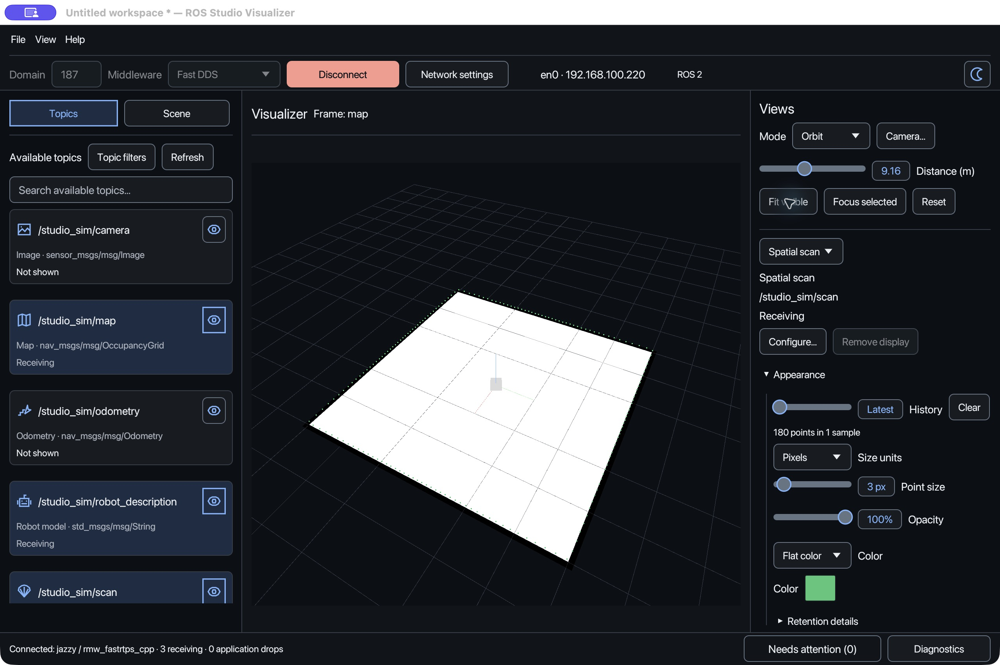
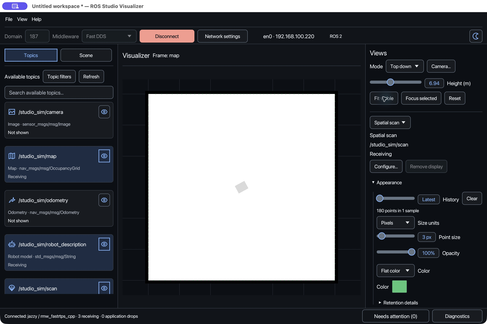
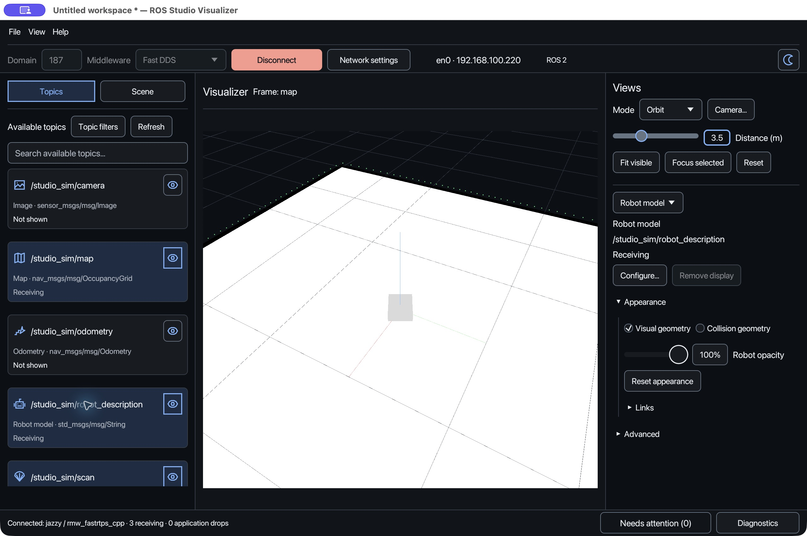
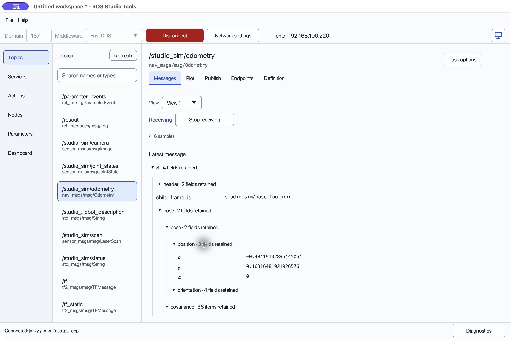
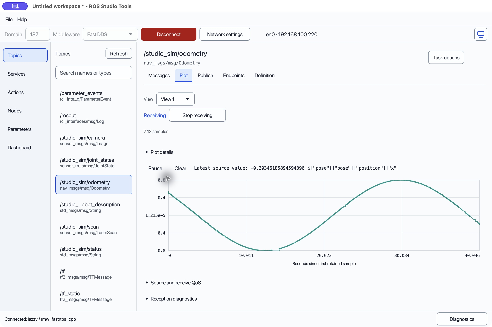
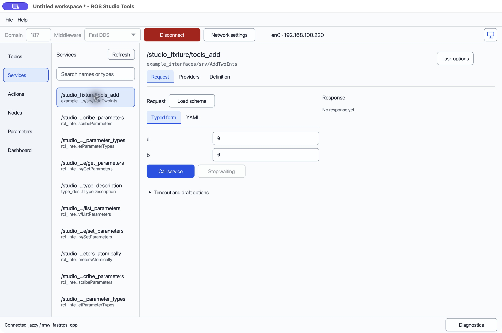

# ROS Studio product description and screenshots

Visualize ROS 2 data. Inspect your system. Understand what is happening.

## Short description

A native desktop suite for visualizing ROS 2 scenes, inspecting messages and
understanding your ROS graph.

## Product description

ROS Studio brings spatial visualization and ROS 2 inspection into one desktop
suite. Open Visualizer to explore robot models, coordinate frames, maps, laser
scans, point clouds, poses and paths in a shared 3D scene. Inspect raw images and
calibrated camera views alongside your spatial data, and adjust display settings
to focus on the information you need.

Open Tools to explore topics, services, actions, nodes and parameters. Read
structured messages, plot numeric fields and preview images. Inspect interface
definitions and endpoints, prepare message publications and service requests,
manage action goals, and edit parameters through explicit operation controls.

Visualizer and Tools run in independent windows, so you can examine a scene while
inspecting the data behind it. Save workspaces to reuse your configuration.
Restoring a workspace or reconnecting keeps operations inactive until you
explicitly start them.

Designed for ROS 2 developers, robotics engineers, educators and students,
ROS Studio provides a focused environment for exploring, debugging and
demonstrating ROS systems.

### Visualizer

See spatial ROS data together: robot geometry, TF frames, maps, LaserScan,
PointCloud2, poses, paths, odometry, covariance and markers. Inspect image streams
and calibrated Camera companions, configure display appearance, and save scene
settings in a workspace.

### Tools

Explore the ROS graph and inspect the data behind your application. View
structured messages, plot numeric values and preview images. Work with topics,
services, actions, nodes and parameters, with explicit controls for operations
that interact with a connected system.

### Availability

ROS Studio remains a development preview targeting ROS 2 Jazzy; see
[platform status and limitations](../reference/limitations.md).

## Screenshots

These are actual macOS development-preview windows captured on 6 November 2026.
They use synthetic data and the actual ROS backend. The Visualizer scenes use a
paused kinematic robot and a generated room map matching the simulated scan
boundaries. The map is known fixture geometry, not SLAM output. Tools' odometry
captures use the moving kinematic simulation; its service form uses a separate
synthetic AddTwoInts endpoint. No service call was issued for that capture.

The images are saved as curated product assets at the user's request. They are
not acceptance reports, store-approved assets or screenshots of Windows/Linux.
The toolbar includes a local development adapter/address; review it and each
store's image requirements before public distribution. No credentials or robot
measurements appear in these captures.

### Visualizer: robot, map and scan overview

### Visualizer: top-down map

### Visualizer: closer robot view

### Tools: odometry messages

### Tools: position plot

### Tools: service request form

